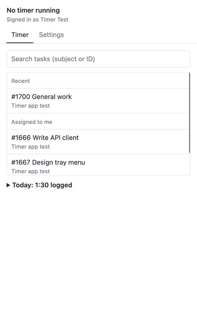
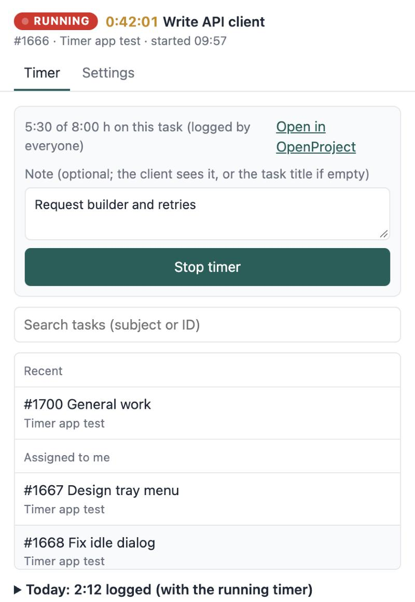
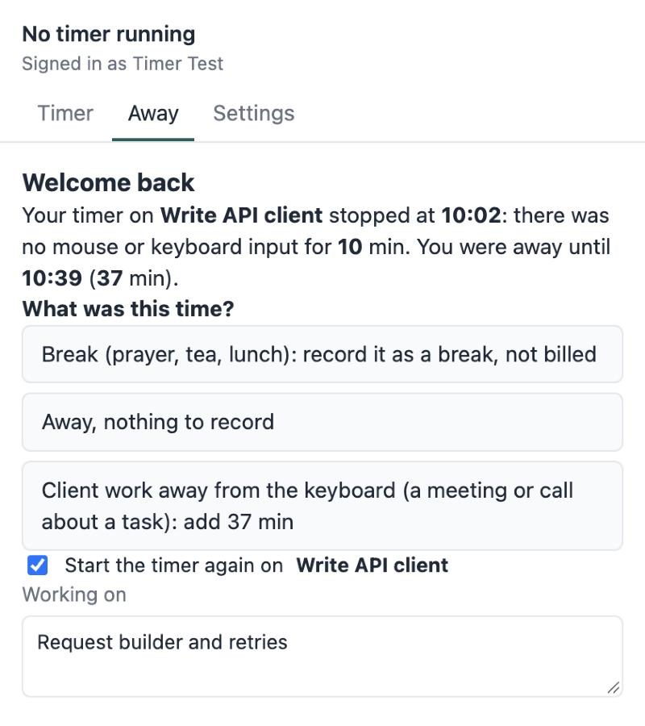
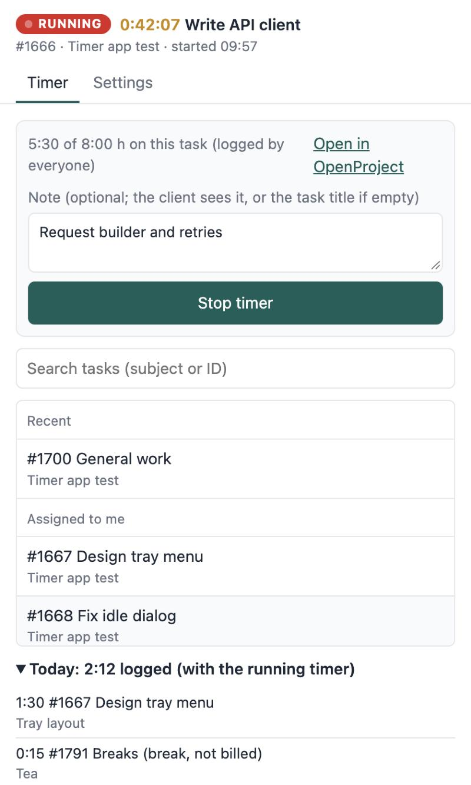
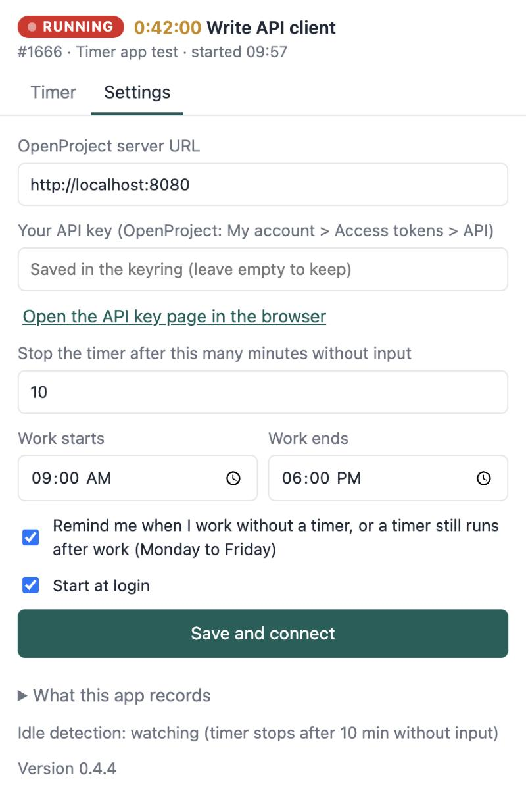

# OpenProject Tray Timer

A small tray app for [OpenProject](https://www.openproject.org/) time tracking. It starts and
stops OpenProject's **own timer**, so the timer also shows in the web UI. When nobody has used
the mouse or keyboard for a while, it stops the timer at the moment input stopped, and asks on
return what that time was.

Built with Tauri 2 (Rust) and a plain HTML/JS window. License: MIT.



| Running timer | Back after being away | Today | Settings |
|---|---|---|---|
|  |  |  |  |

## Platforms

- **Ubuntu 22.04 / 24.04 (GNOME)**: tested (in beta use with a small team). Idle time comes from GNOME's
  `org.gnome.Mutter.IdleMonitor`. The tray icon needs the AppIndicator extension (Ubuntu ships it
  enabled).
- **macOS**: builds and runs, but is untested as a release; no signed builds.
- Other Linux desktops (KDE, Sway, X11 without GNOME) and Windows: idle detection isn't
  implemented, so the timer never stops by itself there. Pull requests welcome.

## What it does

- **Tray**: the running time next to the icon. The menu has *Stop timer*, *Start timer… / Switch
  task*, your recent tasks (one click starts the timer with the note you used last time),
  *Refresh*, *Settings…* and *Quit*.
- **Start**: pick a task (recent and assigned tasks are listed; typing searches every open task
  you can see, by subject or ID) and optionally write a note. The note can be edited while the
  timer runs.
- **Stop**: one click. Hours are the time since the start, rounded to the minute (at least 1).
- **Switch**: pick another task: the running timer stops and a new one starts. *Move the running
  timer here instead* fixes a wrong task.
- **Away**: after 1 to 10 minutes without input (your choice), the timer stops at the moment
  input stopped. Sleep, shutdown and crashes are noticed the same way, from the gap. When you're
  back it asks what that time was: a break, nothing to record, or work away from the keyboard
  (a meeting or call), which is added as its own entry on a task you pick. It also offers to
  restart the timer.
- **Reminders** (Monday to Friday, work hours in Settings, can be turned off): a notification
  when you work for 10 minutes with no timer running, and every hour after work hours while a
  timer still runs.
- **Today**: today's entries and total, and the running task's hours against its estimate.
- **Offline**: when the server can't be reached the timer keeps working. Changes wait in a queue
  with their real times and are sent in order once the server answers.
- **Refused stops**: if the server refuses an entry (HTTP 422), the timer keeps running and the
  window shows the server's reasons so you can fix the note or end time and try again.
- **Adopt**: a timer started in the web UI or on another computer is picked up, and one stopped
  elsewhere is noticed.
- **Updates**: installed apps check your update server and offer to install new versions from the
  tray (see [Your own updates](#your-own-updates)).
- Starts at login (can be turned off). Only one copy runs. *Quit* leaves a running timer running
  in OpenProject.

## Install

[Build the `.deb`](#build) (or download one from a release, when there are releases) and install it:

```bash
sudo apt install ./dwl-timer_<version>_amd64.deb
```

The package and binary are still called `dwl-timer` (the name the project started with).

Then open the app, go to **Settings** and enter your OpenProject URL and an API key (OpenProject:
*My account > Access tokens > API*; Settings has a button that opens that page). The key is kept
in the system keyring (Secret Service on Linux, Keychain on macOS).

## What it records, and what it doesn't

If you roll this out to a team, give them this section.

- **While a timer runs**, it asks the operating system how long it has been since the last mouse
  or keyboard input. It doesn't see what the input was.
- **During work hours with no timer running** (only if reminders are on), it reads the same
  number every 30 seconds to decide whether to remind you. Nothing is stored.
- On the computer only: the running timer's start, when input stopped, a heartbeat every 30
  seconds (to notice sleep), changes waiting to be sent while offline, recent tasks and their
  last notes, and a request log (`requests.log`: time, method, address and status code only,
  never notes, hours or the key, kept under 1 MB).
- **Never recorded:** keystrokes, screenshots, window titles, which apps or websites you use,
  mouse positions.
- **Sent to OpenProject:** only time entries (task, date, hours, note) and task comments you write.

## For OpenProject admins

- The timer needs the **Log own time** permission (plus viewing work packages and own time).
  Without **Edit own time entries**, people can't change an entry after it stopped.
- OpenProject has no permission that allows the timer but not manual entries. A timer's entry is
  created when it starts and updated when it stops, so an entry whose hours are more than
  `updated_at - created_at` was typed in or changed by hand.
- The server trusts the hours the client sends. If billing depends on them, check them on the
  server too.
- Tested against OpenProject 17.9.

### Optional server conventions

The app works on any OpenProject. A few conventions turn on extra behaviour:

- **A task titled "General work"**: starting a timer on it requires a note
  (`NOTE_REQUIRED_TASKS` in `src-tauri/src/tracker.rs`).
- **An open task titled "Breaks"**: when it exists, the away question offers *Break*, logged on
  that task. Put it in a project you never bill.
- **An optional server rules plugin** that refuses time entries with HTTP 422 and a list of
  messages (for example: too many hours, a task over its estimate, words not allowed in notes).
  The app shows the messages and keeps the timer running. When a message says the task is over
  its estimate, the app asks for a reason and posts it as a comment on the task before trying
  again. Without such a plugin, nothing is refused.

## Build

Needs Rust (stable, 1.80+) and Node.js (only for the Tauri CLI).

On Ubuntu:

```bash
sudo apt install libwebkit2gtk-4.1-dev libayatana-appindicator3-dev librsvg2-dev libssl-dev build-essential curl file
npm install
npm run dev     # run in development
npm run build   # release build: .deb on Linux, .app on macOS (src-tauri/target/release/bundle)
```

Or build the Ubuntu `.deb` in Docker from any machine: `scripts/build-deb-docker.sh` writes it to
`dist/`. On an Apple Silicon Mac use Colima with Rosetta (`colima start --vz-rosetta`).

See [CONTRIBUTING.md](CONTRIBUTING.md) for tests and the UI preview, and [CHANGELOG.md](CHANGELOG.md) for what changed.

## Your own updates

Installed apps update themselves from a `latest.json` that you host. If you build and distribute
the app yourself, set up your own updater key and endpoint first:

1. Make a signing key: `npx tauri signer generate -w ~/.tauri/dwl-timer.key`. Keep a backup: without
   it, installed apps can't be updated any more.
2. In `src-tauri/tauri.conf.json`, set `plugins.updater.pubkey` to the public key it printed, and
   `plugins.updater.endpoints` to `https://<your server>/<folder>/latest.json`.
3. Build, then publish each release:

   ```bash
   UPDATE_SSH=deploy@example.com UPDATE_DIR=/var/www/timer UPDATE_URL=https://example.com/timer \
     scripts/publish-update.sh dist/dwl-timer_<version>_amd64.deb "What changed"
   ```

   It signs the package, writes `latest.json` and copies both to `UPDATE_DIR` on the server over
   ssh. `UPDATE_DIR` must be served by a web server at `UPDATE_URL`. `TAURI_KEY` overrides the key
   path. Installed apps check a minute after starting and every 6 hours.

Bump the version in `package.json`, `src-tauri/Cargo.toml` and `src-tauri/tauri.conf.json` for each
release.

## Layout

| Path | What |
|---|---|
| `src-tauri/src/api.rs` | OpenProject API v3 calls |
| `src-tauri/src/tracker.rs` | Idle and heartbeat bookkeeping, hours (pure, unit-tested) |
| `src-tauri/src/remind.rs` | When to remind (pure, unit-tested) |
| `src-tauri/src/core.rs` | The timer's behaviour: API + bookkeeping, no UI |
| `src-tauri/src/idle.rs` | Idle sources: GNOME D-Bus, macOS, "unavailable" elsewhere |
| `src-tauri/src/queue.rs` | Offline queue (pure, unit-tested) |
| `src-tauri/src/settings.rs` | Settings file, keyring, recent tasks |
| `src-tauri/src/lib.rs` | Tauri glue: tray, window, background refresh |
| `ui/` | The window |
| `dev/` | Browser preview of the window with a mock backend |

## OpenProject API notes

- Start: `POST /api/v3/time_entries` with `ongoing: true`, `spentOn` and an `entity` link to the
  work package.
- Stop: `PATCH /api/v3/time_entries/{id}` with `ongoing: false`, `hours` (ISO 8601; the server
  doesn't compute it) and `comment`.

## Ideas

- Exact sleep and lock events (logind `PrepareForSleep`, screensaver signals) instead of the
  heartbeat gap.
- Idle detection on other desktops: `ext-idle-notify-v1` (KDE, Sway), XScreenSaver, Windows
  `GetLastInputInfo`.
- An activity picker, configurable work days, signed macOS builds, CI that publishes updates.

## License

MIT, see [LICENSE](LICENSE).
